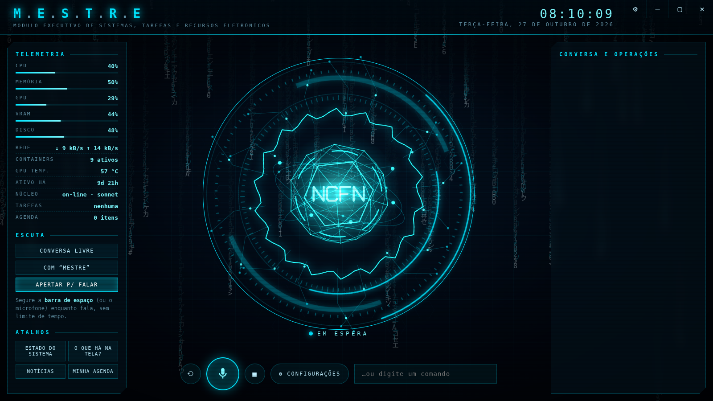
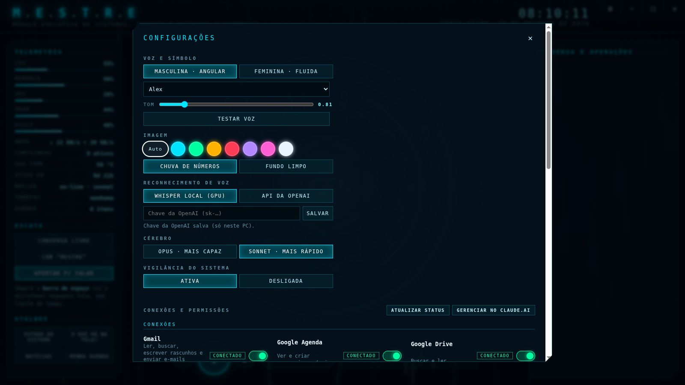

# MESTRE

**Módulo Executivo de Sistemas, Tarefas e Recursos Eletrônicos** é um assistente de voz local para Linux, no estilo do JARVIS do Homem de Ferro. Ele conversa em português, controla o computador, navega na internet, cuida da agenda e trabalha sozinho em segundo plano. Na tela aparece um símbolo holográfico **NCFN** que reage à voz e às emoções.



O cérebro é o [Claude Code](https://docs.anthropic.com/claude-code). O MESTRE não tem modelo de linguagem próprio: ele conecta o Claude a três peças locais.
- **Ouvido:** reconhecimento de voz pelo Whisper, na GPU.
- **Voz:** fala neural em português com o Kokoro.
- **Interface:** a tela do assistente, com o símbolo NCFN.

Um **guardião** fica entre o cérebro e o computador e pede confirmação antes de qualquer ação perigosa.

---

## Sumário

- [O que ele faz](#o-que-ele-faz)
- [Como funciona](#como-funciona)
- [Requisitos](#requisitos)
- [Instalação](#instalação)
- [Uso](#uso)
- [Configurações](#configurações)
- [Segurança](#segurança)
- [Autonomia: agenda, tarefas e vigilância](#autonomia-agenda-tarefas-e-vigilância)
- [Estrutura do projeto](#estrutura-do-projeto)
- [Personalização](#personalização)
- [Solução de problemas](#solução-de-problemas)
- [Privacidade](#privacidade)

---

## O que ele faz

| Área | Exemplos de pedido |
|---|---|
| Conversa | "O que você acha desse plano?", "Me explique como funciona um túnel da Cloudflare." |
| Computador | "Abra o YouTube", "Aumente o volume", "O que tem na minha tela?", "Copie esse texto." |
| Internet | "Quais são as notícias de hoje?", "Pesquise o preço do RTX 5070 e compare três lojas." |
| Arquivos e sistema | "Quanto espaço livre tenho?", "Liste os containers parados", "Crie um relatório em PDF sobre…" |
| Conta Google (opcional) | "Tenho e-mails novos do banco?", "O que tenho na agenda amanhã?" |
| Notícias (NewsFlash) | "Quais as notícias dos meus feeds?", "Leia essa notícia sobre a Apple", "Tem algo sobre o Brasileirão?" |
| Agenda | "Me lembre às 15h de ligar para o cliente", "Todo dia útil às 8h, me dê um resumo do dia." |
| Segundo plano | "Pesquise a fundo X e me avise quando terminar"; a conversa continua livre enquanto isso. |
| Câmera (opcional) | "Olhe pela câmera e me diga o que vê." |

---

## Como funciona

```
 Microfone ──► Navegador (interface) ──WebSocket──► server.py ──► Whisper (GPU) ──► texto
                    ▲                                    │
                    │  áudio da fala + emoção            ▼
 Alto-falante ◄─────┴──────── Kokoro (voz) ◄── frases ◄── Claude Code (cérebro, stream-json)
                                                         │
                                       hooks/guard.py ◄──┤ cada ação passa pelo guardião
                                                         ▼
                      terminal · mestre-pc (tela, mouse, teclado, câmera, som)
                      navegador automático · Gmail/Agenda/Drive · agenda · tarefas
```

1. **Ouvir:** a interface capta o microfone e detecta quando você fala.
   - Os modos de escuta são conversa livre, palavra de ativação ou apertar para falar.
   - O áudio vai em PCM de 16 kHz para o servidor.
   - O Whisper transcreve, localmente na GPU ou, se você escolher, pela API da OpenAI.
2. **Pensar:** o texto vai para um processo do **Claude Code** que fica sempre aberto e lembra a conversa.
   - A personalidade e as regras estão em `persona.md`.
   - O Claude usa as ferramentas que estiverem liberadas: terminal, navegador, conectores e os comandos `mestre-*`.
3. **Proteger:** antes de cada ação, o **guardião** (`hooks/guard.py`) decide se ela passa.
   - Ações perigosas são barradas até você confirmar.
   - Permissões desligadas são recusadas sem confirmação.
4. **Falar:** a resposta chega em fluxo e é dividida em frases.
   - Cada frase vira áudio no **Kokoro**, cerca de 0,2 s por frase na GPU, e já começa a tocar enquanto o resto é gerado.
   - O Claude marca a emoção de cada trecho (`[feliz]`, `[preocupado]`…), e o símbolo NCFN muda de comportamento exatamente quando aquela frase é falada.
5. **Agir sozinho:** em paralelo, o servidor cuida da agenda, das tarefas em segundo plano e da vigilância do sistema, e avisa por voz quando algo acontece.

---

## Requisitos

- **Linux com X11.** Testado no Zorin OS, que é baseado no Ubuntu 24.04. No Wayland, o controle de mouse, teclado e janelas não funciona.
- **Python 3.11 ou mais novo** e **Google Chrome**.
- **[Claude Code](https://docs.anthropic.com/claude-code) instalado e autenticado.** O comando `claude` precisa funcionar no terminal.
  - O uso conta no seu plano do Claude.
- **GPU NVIDIA**, recomendada. Sem ela tudo funciona na CPU, mas a fala e o reconhecimento ficam mais lentos.
- **Espaço em disco:** cerca de 8 GB para o ambiente Python (PyTorch e CUDA) e os modelos.

---

## Instalação

```bash
git clone https://github.com/natanaelfleuri/NCFN-MESTRE.git ~/mestre
cd ~/mestre
./install.sh
```

O instalador roda sem sudo e faz o seguinte:

1. Cria o ambiente Python em `.venv` e instala as dependências de `requirements.txt`.
2. Baixa a voz de reserva (Piper). O Whisper (cerca de 1,6 GB) e o Kokoro (cerca de 330 MB) baixam sozinhos no primeiro uso.
3. Cria o `config.json` a partir de `config.example.json`.
4. Instala:
   - o serviço `~/.config/systemd/user/mestre.service`;
   - o lançador `~/.local/bin/mestre`;
   - o ícone **MESTRE** na área de trabalho e no menu.

Para desinstalar, rode `./uninstall.sh`. Ele não apaga a pasta do projeto.

---

## Uso

Clique no ícone **MESTRE**, ou rode `mestre` no terminal. A janela abre em tela cheia e o MESTRE cumprimenta você.

| Ação | Como |
|---|---|
| Falar | No modo **Conversa livre**, basta falar. Também dá para segurar a **barra de espaço** (sem limite de tempo) ou o botão do microfone. |
| Digitar | Caixa "…ou digite um comando" |
| Interromper a fala | **Esc** ou ■ |
| Nova conversa | ⟲ |
| Configurações | Botão **⚙ Configurações** ou ⚙ no canto superior |
| Minimizar, maximizar ou fechar | Botões – ▢ ✕ no canto superior direito. O ✕ fecha e desliga o servidor. |
| Reabrir a janela minimizada | Clique no ícone MESTRE de novo |

### Modos de escuta

| Modo | Comportamento |
|---|---|
| **Conversa livre** (padrão) | Ouve e responde a tudo o que você falar. Corta a frase depois de 0,9 s de silêncio ou 30 s de fala. |
| **Com "Mestre"** | Só responde quando ouve "Mestre" na frase. Depois de cada resposta, aceita a continuação sem o nome por 12 s. |
| **Apertar p/ falar** | Só escuta com o espaço ou o microfone apertado. |

Enquanto o MESTRE fala, ele não escuta, para não ouvir a própria voz. Para interromper, use o espaço ou o Esc.

### Comandos de terminal

```bash
mestre            # abre, ou traz a janela para frente
mestre status     # ligado ou desligado
mestre stop       # fecha e desliga
mestre-pc help    # controle da área de trabalho (o cérebro usa este comando)
mestre-agenda listar
mestre-tarefa "pesquise X e salve um resumo"
```

---

## Configurações



| Seção | Opções |
|---|---|
| **Voz e símbolo** | Voz masculina (Alex, Santa ou Faber) com símbolo **angular**, ou feminina (Dora) com símbolo **fluido**. Controle de **tom** e botão **Testar voz**. |
| **Imagem** | Cor do holograma (automática, ciano, verde, âmbar, vermelho, roxo, rosa ou branco) e chuva de números ligada ou desligada |
| **Reconhecimento de voz** | Whisper local (padrão) ou **API da OpenAI** (`gpt-4o-transcribe`). A chave fica só em `state/secrets.json` (chmod 600). Se a OpenAI falhar, ele volta sozinho para o Whisper. |
| **Cérebro** | Opus (mais capaz) ou Sonnet (mais rápido) |
| **Vigilância do sistema** | Ativa ou desligada |
| **Conexões e permissões** | Uma chave liga/desliga para cada capacidade (lista abaixo) |
| **Sempre permitidos** | Ações que você liberou de vez, com botão para revogar |
| **Agenda** | Lembretes e tarefas agendadas, com botão para remover |

### Conexões e permissões

| Grupo | Permissões |
|---|---|
| Conexões | Gmail, Google Agenda, Google Drive, Claude Docs, Cloudflare |
| Internet | Pesquisa na internet, navegador automático (Playwright), notícias (NewsFlash) |
| Dispositivos | **Câmera** (vem desligada), ver a tela, mouse e teclado, abrir programas e sites, área de transferência, som e mídia |
| Sistema | Terminal, criar e editar arquivos, Docker, áreas protegidas |
| Autonomia | Agenda e lembretes, tarefas em segundo plano, memória da conversa |

- **Conexões:** são os conectores da sua conta Claude. O status aparece ao lado de cada uma: conectado, precisa entrar ou falhou.
- **Conectar:** o botão pede ao MESTRE que abra a página de login do conector.
- **Gerenciar no claude.ai:** abre a página de conectores da sua conta.

O que está **desligado** some do cérebro. Ferramentas inteiras ficam fora do Claude, e comandos específicos são barrados pelo guardião. O MESTRE avisa que a permissão está desligada e não tenta outro caminho.

---

## Segurança

O MESTRE roda o Claude Code com acesso ao seu computador. Por isso toda ação passa pelo guardião (`hooks/guard.py`), um gancho `PreToolUse` do Claude Code:

- **Liberadas sem pergunta:** leitura, consultas, navegação, abrir programas e escrever em `~/Documentos/MESTRE`.
- **Pedem confirmação:**
  - apagar ou mover arquivos, sobrescrever com `>`;
  - `sudo`, instalar ou remover programas, `systemctl`;
  - `docker rm/stop/down/exec`, `git push/reset`, `crontab`;
  - enviar dados (`curl -X POST`, `scp`, `ssh`, e-mail);
  - ler segredos (`.env`, chaves SSH, `credentials`…);
  - mexer nas **áreas protegidas** (`protected_paths` no `config.json`);
  - alterar arquivos fora da pasta do MESTRE;
  - conectores que agem para fora (enviar e-mail, criar evento…).
- **A confirmação** abre uma caixa com **Confirmar sempre**, **Só desta vez** e **Negar**. Também vale por voz: "confirmo", "confirmo sempre", "cancela".
  - A aprovação vale para **aquela chamada exata**.
  - "Sempre" grava a regra em `state/always.json`, revogável nas Configurações.
- **Tarefas autônomas** (agenda e segundo plano) não têm quem confirme, então nelas toda ação protegida é **negada** e aparece como pendência no relatório.
- **Permissões desligadas** são recusadas sem oferecer confirmação.

> O guardião é uma camada de proteção, não uma garantia absoluta. Ele bloqueia padrões perigosos conhecidos. Revise as permissões e não deixe o MESTRE em "conversa livre" num ambiente com outras pessoas falando, como TV ou reuniões.

---

## Autonomia: agenda, tarefas e vigilância

- **Lembretes:** na hora marcada, o MESTRE **fala** o lembrete e mostra uma notificação.
  ```bash
  mestre-agenda lembrete "15:30" "ligar para o cliente"
  mestre-agenda lembrete "+20m" "tirar o café"
  ```
- **Tarefas agendadas:** na hora marcada, ele executa o pedido sozinho e fala o resultado.
  ```bash
  mestre-agenda tarefa "2026-11-03 08:00" "resumo das notícias e do estado dos meus serviços" --repetir dias-uteis
  ```
  As repetições possíveis são `diario`, `dias-uteis`, `semanal`, `horas:N` e `minutos:N`.
- **Segundo plano:** `mestre-tarefa "…"` executa um trabalho longo num processo separado. Quando termina, ele fala o resumo e salva um relatório em `~/Documentos/MESTRE/relatorios/`.
- **Vigilância** (a cada minuto): avisa por voz e por notificação, uma vez por problema, quando:
  - o disco passa de 90%;
  - a GPU passa de 85 °C ou o processador de 95 °C;
  - a memória passa de 92%;
  - a bateria fica fraca com o carregador desligado;
  - um **container Docker para**;
  - um endereço de `watch_urls` deixa de responder.

Na conversa, basta pedir: "me lembre…", "todo dia às…", "faça isso em segundo plano".

---

## Notícias (NewsFlash)

Se o leitor de RSS [NewsFlash](https://flathub.org/apps/io.gitlab.news_flash.NewsFlash) estiver instalado (Flatpak ou nativo), o MESTRE usa **as suas assinaturas e categorias** dele:

- **Faixa de manchetes:** passa embaixo do símbolo, atualizada a cada 10 minutos. Clicar numa manchete faz o MESTRE ler e resumir a notícia.
- **Por voz:** "quais as notícias?", "notícias de esportes", "leia essa", "tem algo sobre X?".
- **Comando `mestre-noticias`:**
  ```bash
  mestre-noticias manchetes [--categoria TECNOLOGIA] [--fonte X] [--n 15]
  mestre-noticias feeds
  mestre-noticias buscar "termo"
  mestre-noticias ler <url>
  mestre-noticias abrir        # abre o aplicativo NewsFlash
  ```
- **Origem das notícias:** as manchetes vêm **ao vivo** dos feeds, então não dependem de o NewsFlash ter sincronizado. Sem internet, ele usa as notícias guardadas pelo NewsFlash.
- **Banco do NewsFlash:** é aberto **só para leitura**. Para assinar ou remover feeds, use o próprio NewsFlash.
- **Desligar:** em Configurações, a permissão **Notícias (NewsFlash)** e a opção **Faixa de notícias**.

---

## Estrutura do projeto

```
server.py            servidor FastAPI: WebSocket, ouvido, voz, cérebro, agenda, vigilância
persona.md           personalidade e regras do MESTRE (prompt do sistema)
persona.local.md     contexto pessoal opcional (ignorado pelo git)
permissions.py       catálogo de permissões (ferramentas e padrões de comando)
hooks/guard.py       guardião: confirmação, "sempre permitidos" e permissões
bin/mestre-pc        tela, mouse, teclado, janelas, câmera, área de transferência, volume
bin/mestre-agenda    lembretes e tarefas agendadas
bin/mestre-tarefa    tarefas em segundo plano
bin/mestre-noticias  notícias dos feeds do NewsFlash
news.py              leitura do NewsFlash e dos feeds RSS/Atom
ui/                  interface: index.html, style.css, app.js, symbol.js (símbolo NCFN)
install/             modelos do serviço systemd, do lançador e do atalho
config.example.json  configuração inicial (vira config.json)
state/               chaves, sessão, permissões e agenda (ignorado pelo git)
models/              modelos de voz baixados (ignorado pelo git)
```

### Protocolo da interface (`/ws`)

| Direção | Mensagem |
|---|---|
| interface → servidor | áudio PCM int16 16 kHz (binário); `{type:'text'}`, `decision`, `stop`, `reset`, `greet`, `test_voice` |
| servidor → interface | `status`, `user`, `delta` (texto da resposta), `say` (áudio WAV + emoção), `emotion`, `tool`, `pending`, `approved`, `denied`, `task`, `reminder`, `alert`, `agenda`, `settings` |

APIs HTTP:
- `GET /api/stats` e `GET/POST /api/settings`;
- `GET /api/connections` e `POST /api/connect/{id}`;
- `GET/POST/DELETE /api/agenda` e `POST /api/task`;
- `GET /api/news` (manchetes do NewsFlash);
- `POST /api/window/{minimize|maximize|close}`.

---

## Personalização

- **Personalidade:** edite `persona.md`. Para dar ao MESTRE contexto sobre você (profissão, projetos, máquinas) sem publicar nada, crie `persona.local.md`.
- **Áreas protegidas:** em `config.json`, `"protected_paths": ["~/projetos/importante", "COFRE"]`.
- **Endereços vigiados:** em `config.json`, `"watch_urls": {"meu site": "http://127.0.0.1:8080/"}`.
- **Vozes:** em `config.json`, na chave `voices`.
  - Vozes do Kokoro em português: `pm_alex`, `pm_santa`, `pf_dora`.
  - `pitch` abaixo de 1 deixa a voz mais grave.
- **Símbolo:** o visual fica em `ui/symbol.js`.
  - `MOODS` define o comportamento de cada emoção.
  - A variante `angular` ou `fluida` acompanha a voz escolhida.
- **Porta:** 7777, no lançador e no serviço.

Depois de mudar `server.py` ou `persona.md`, rode `systemctl --user restart mestre`.

---

## Solução de problemas

| Problema | Solução |
|---|---|
| "Sem conexão" na tela | O servidor não está rodando. Veja `systemctl --user status mestre` e `journalctl --user -u mestre -n 50`. |
| Não reage à voz | Confira o modo de escuta. Em **Com "Mestre"**, frases sem o nome aparecem no painel como ignoradas. Teste segurando o espaço. |
| Ouve frases que ninguém disse | Ruído de fundo. Use **Com "Mestre"** ou **Apertar p/ falar**. |
| Minimizar, maximizar ou ver a tela não funciona | O serviço precisa da tela da sessão. O lançador roda `systemctl --user import-environment DISPLAY XAUTHORITY`. Abra sempre pelo ícone ou por `mestre`. |
| Voz robótica | O Kokoro não carregou e ele usou o Piper de reserva. Veja os logs. Na primeira vez, o download leva alguns minutos. |
| Conector "precisa entrar" | Clique em **Conectar** nas Configurações e faça o login na página que abrir. |
| OpenAI falha | A API da OpenAI cobra à parte da assinatura do ChatGPT. Sem crédito, o MESTRE volta sozinho para o Whisper local. |

---

## Privacidade

- **Ouvido e voz:** rodam **localmente**. O áudio só sai do computador se você escolher a API da OpenAI.
- **Cérebro:** o texto das conversas vai para a Anthropic, porque o cérebro é o Claude Code. Vale a mesma política da sua conta Claude.
- **Chaves e estado local:** chaves de API, permissões, sessão e agenda ficam em `state/`. O perfil do Chrome do app também. Nada disso vai para o git.
- **Fotos e capturas:** a câmera vem desligada. Capturas de tela e fotos são salvas só em `/tmp` e lidas pelo cérebro quando você pede.

---

Projeto NCFN.
